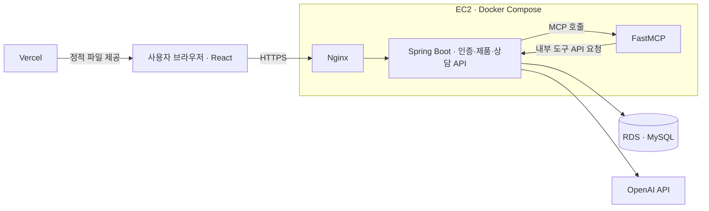

# HomeCare AI

등록한 가전의 증상을 상담하고, 제품 정보에 따른 보증·참고 수리비·공식 서비스 경로를 안내하는 서비스입니다. 냉장고·세탁기·건조기·식기세척기를 대상으로 제품 등록부터 상담 이력 조회까지 연결합니다.

**사용 흐름** · 로그인 → 제품 등록 → 증상 상담 → 결과 확인 → 상담 이력 조회

## 팀 구성과 담당 범위

부트캠프 **5인 팀 프로젝트**로, 프로젝트 발표를 완료했습니다.

| 구분      | 담당 범위                                                              |
| --------- | ---------------------------------------------------------------------- |
| 본인      | 백엔드·프론트엔드 개발, DB, 인프라 구축, CI/CD, MCP 기능 연동          |
| 통합 작업 | 팀의 MCP 기능을 기존 서비스에 연결하고 API·DB 호환성 수정 및 통합 배포 |
| 팀원 협업 | MCP 내부 기능, 데이터 분석, 웹 디자인, 기능 기획을 각각 담당           |

## 주요 기능

- **제품 등록·관리:** 모델·구매 정보와 지역을 저장하고 상담할 제품을 선택합니다.
- **증상 상담:** 제품의 증상을 입력하고 확인 질문을 통해 상담을 이어갑니다.
- **결과 확인:** 자료가 있는 범위에서 보증 정보, 참고 수리비, 공식 서비스 경로를 안내합니다.
- **상담 이력 조회:** 계정별로 저장된 이전 상담과 결과를 다시 확인합니다.

## 시스템 구조와 기술

Spring Boot의 Agent와 내부 도구 API는 같은 백엔드 프로세스에 포함됩니다. FastMCP는 요청별 JWT를 전달하고 Spring에서 인증·계정과 데이터 소유권을 검증합니다. Spring·MCP 포트와 `/api/tools`는 외부에 공개하지 않습니다.

| 영역         | 기술과 용도                                                                                                   |
| ------------ | ------------------------------------------------------------------------------------------------------------- |
| 백엔드·DB    | Java 21, Spring Boot, Spring Security, JPA, MySQL — 인증·제품·상담 API와 데이터 저장                          |
| DB 변경 관리 | Flyway — 버전별 SQL 적용과 변경 이력·체크섬 관리                                                              |
| 프론트엔드   | React, Vite — 제품·상담·이력 화면과 서버 API 연결                                                             |
| MCP 연동     | Spring Agent, Python FastMCP — HTTP·JWT 기반 도구 호출 연결                                                   |
| 인프라·배포  | EC2, RDS, ECR, Docker Compose, GitHub Actions, OIDC, SSM, Terraform, Vercel — 인프라 구성·자동 배포·실패 복구 |

## 주요 문제 해결과 코드

| 사례                                       | 적용한 처리와 확인한 동작                                                                                                                                                               | 구현·검증 근거                                                                                                                                                                                                                                                                  |
| ------------------------------------------ | --------------------------------------------------------------------------------------------------------------------------------------------------------------------------------------- | ------------------------------------------------------------------------------------------------------------------------------------------------------------------------------------------------------------------------------------------------------------------------------- |
| **기존 데이터를 보존하며 MCP 스키마 통합** | V001·V002를 유지하고 V003·V004를 추가했습니다. `ops/sql`을 원본으로 통일하고 기존 제품·상담 보존, 구버전 쓰기와 재실행 호환성을 검증했습니다.                                           | [DB 변경 관리](ops/DATABASE_MIGRATIONS.md) · [마이그레이션 테스트](backend/src/test/java/com/project/backend/migration/DatabaseMigrationTests.java)                                                                                                                             |
| **탈퇴·재가입 후 이전 토큰 차단**          | JWT의 회원 ID·이메일을 현재 계정과 대조합니다. 제품·상담에는 소유자 조건을 적용하고 탈퇴 데이터는 한 트랜잭션으로 삭제합니다. 이전 토큰·타인 접근 거부와 삭제 범위를 검증했습니다.      | [JWT 검증](backend/src/main/java/com/project/backend/config/JwtConfig.java) · [탈퇴 처리](backend/src/main/java/com/project/backend/auth/AuthService.java) · [API 테스트](backend/src/test/java/com/project/backend/BackendApplicationTests.java)                               |
| **CI 통과 이후의 MCP 배포 실패 해결**      | ECR 이미지 조회 실패를 추적해 저장소 설정을 보완하고 리소스·권한을 점검했습니다. MCP 컨테이너 연결과 Agent 활성화를 반영한 뒤 재배포 및 실제 웹 상담 동작을 확인했습니다.               | [배포 변경 커밋](https://github.com/gwonu1/core_project/commit/421065adf3c1561aef38e7bfec1db15426bd5d95) · [ECR 조회 코드](ops/deploy/ci-release.py) · [배포 테스트](ops/tests/test_deployment.py)                                                                              |
| **실패 시점에 따른 배포 중단·복구**        | 설정·이미지 준비와 DB 변경 실패 시 교체를 중단합니다. 교체 후 상태 검사 실패 시 이전 정상 릴리스가 있으면 이미지·설정·Compose를 복원합니다. MCP 도입 전 구성으로의 복구도 검증했습니다. | [배포·복구 구현](ops/deploy/deploy-service.sh) · [회귀 테스트](ops/tests/test_deployment.py)                                                                                                                                                                                    |
| **제품 등록을 막는 지역명 처리 오류 수정** | 긴 접미사부터 정규화하고 필요한 허용 값만 추가했습니다. 등록·수정 API와 저장 값, 기존 지역명 유지 및 미지원 입력 거부를 검증했습니다.                                                   | [정규화 코드](backend/src/main/java/com/project/backend/product/UserProductService.java) · [단위 테스트](backend/src/test/java/com/project/backend/product/UserProductServiceTests.java) · [API 테스트](backend/src/test/java/com/project/backend/BackendApplicationTests.java) |

## 실행 및 검증 안내

| 구성요소   | 준비 사항과 상세 문서                                                                     |
| ---------- | ----------------------------------------------------------------------------------------- |
| 백엔드     | Java 21, MySQL, JWT·AI 환경 설정 — [실행·API·테스트 안내](backend/README.md)              |
| 프론트엔드 | Node 24, API 연결 설정 — [화면 실행·빌드 안내](frontend/README.md)                        |
| MCP        | Python, Spring 백엔드와 HTTP 연결 설정 — [MCP 실행·검증 안내](mcp_server/README.md)       |
| 운영       | [CI/CD 구성](ops/docs/ci_cd.md) · [DB 변경 적용과 MySQL 검증](ops/DATABASE_MIGRATIONS.md) |

위 테스트 링크는 접근 차단·데이터 보존·실패 복구·입력 검증 조건을 확인하는 코드입니다. 일반 회귀 검사, 별도 MySQL 통합 검사, 실제 AI 모델 평가는 구분해서 실행합니다.

과거 실행 결과는 [MCP 통합 커밋의 검증 기록](https://github.com/gwonu1/core_project/commit/b1a4049c9e7c1c2f928384c05f7a825c22a4cf2f)과 [2026-10-13 배포·복구 기록](https://github.com/gwonu1/core_project/blob/f149048acd42cf18f1e2ac1cc1c5b49fe6506fb0/ops/STAGE7_RELEASE.json)에서 확인할 수 있습니다. MCP 통합 배포 후 실제 웹 상담은 별도로 수동 확인했으며, 이 기록들은 당시의 결과입니다.

## 참고 사항

- 비용은 참고 범위이며 확정 견적이 아닙니다. 공식 서비스 경로를 안내하며 예약·접수 전송은 수행하지 않습니다.
